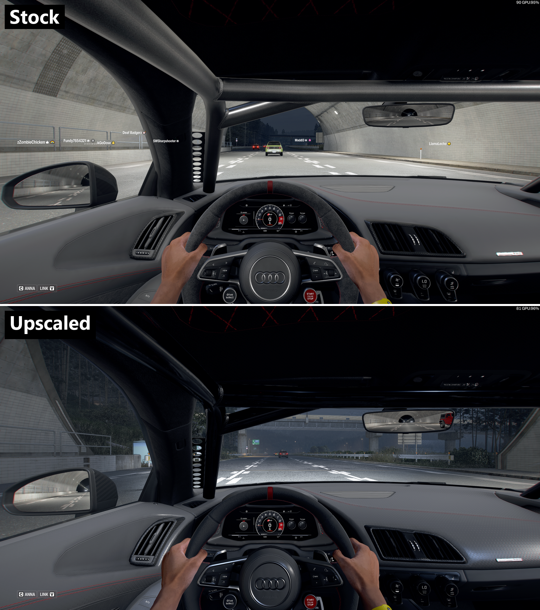

# fh6upscale

Upscales Forza Horizon 6 car interior textures on your own PC install. Leather grain, plastics, fabrics, perforated panels, speaker grilles and more get twice the resolution on each side by default (4x the pixels), or 4x per side with `--scale 4`. The game loads the result through its `mediapc` override folder, so the original game files are never modified.



The tool ships no game content. It reads textures from your install, upscales them locally with Real-ESRGAN, and writes an override next to the game.

## Requirements

- Windows, Forza Horizon 6 on PC (Xbox app or Steam)
- Python 3.10 or newer
- A GPU with Vulkan support
- Disk space: about 40 GB free for a run over every car

texconv (Microsoft DirectXTex) and Real-ESRGAN (ncnn Vulkan build) are downloaded from their official GitHub releases by `setup-tools`. Neither is bundled here.

## Usage

Close the game before `pack` and `restore`.

```
python fh6up.py detect
python fh6up.py setup-tools

python fh6up.py list all        # count, size breakdown and time estimate
python fh6up.py prep all        # upscale; resumable, Ctrl+C is safe
python fh6up.py build all       # write game-format textures (add --calm, see below)
python fh6up.py pack            # install the override
```

Instead of `all`, pass a single car's file name from `media\cars`, for example `MER_E63SAMG_18`. Use `smoke` for the tire smoke textures, then `pack smoke`.

Undo with `python fh6up.py restore` (or `restore smoke`).

Options, placed before the command:

- `--scale 2` (default) or `--scale 4`. Use the same value for `prep`, `build` and `pack`. The two scales keep separate work folders, so you can prepare both and switch between them.
- `--workers N` for parallel prep (default 4).
- `--game <folder>` if detection fails.

`build --calm` puts upscaled data only in the largest mip levels and keeps the game's original data for every smaller level. You get the extra detail up close, and at normal viewing distance the textures behave exactly like stock. Use it if fine repeating patterns (carbon weave, perforation, mesh) shimmer or swim after upscaling. It only changes the build step, so no re-prep is needed.

## What it does

1. Scans each car's interior models and the shared materials they use, and collects the textures from `media\cars\_library\Textures.zip`. Tiny flat swatches and stitching are skipped.
2. Converts each texture to DDS, upscales it, and re-encodes it in its original format with a full mip chain. Masks, color and roughness maps go through Real-ESRGAN at 4x and are then resized to the chosen scale. Normal maps and motion vectors use a cubic resize, because AI upscaling distorts the directions they store.
3. Rebuilds each texture in the game's `.swatchbin` format. Before writing, it rebuilds the original from its own pixels and checks the result is identical byte for byte, so any layout mismatch can be caught.
4. Writes a copy of the texture archive with the upscaled files swapped in to `mediapc`.

The container format is documented in [FORMAT.md](FORMAT.md).

## Timing

On an RTX 5080 with 4 workers, every car interior (about 5,500 textures) takes a few hours. Prep is CPU heavy as well as GPU heavy, mainly from BC7 encoding.

`--scale 4` over every car uses a lot of video memory. On a 16 GB card, usage reached about 12.6 GB, which is why `--scale 2` is the default.

## Notes

- The changes are visual and local. Other players do not see your textures. Modifying game files carries some risk, as with any mod.
- Game updates can change textures. After an update, delete the work folder in `%LOCALAPPDATA%\fh6up\work` and run again.
- Digital gauge screens render into a fixed 1280x720 buffer in the engine, so upscaling their art does not sharpen them :(
- Do not redistribute the generated textures. They are derived from the game's assets!

## License

MIT for this repository's code and documentation. texconv is MIT licensed by Microsoft. Real-ESRGAN and its models are BSD-3-Clause licensed by Xintao Wang.
